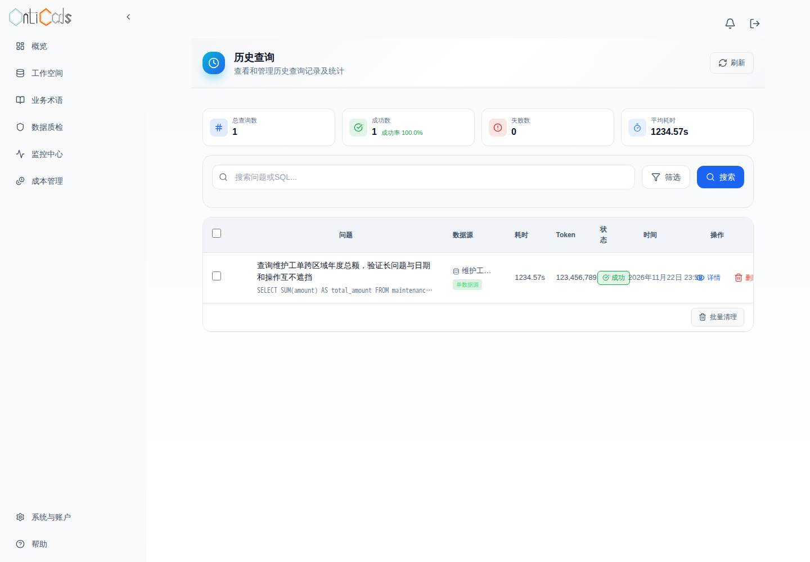
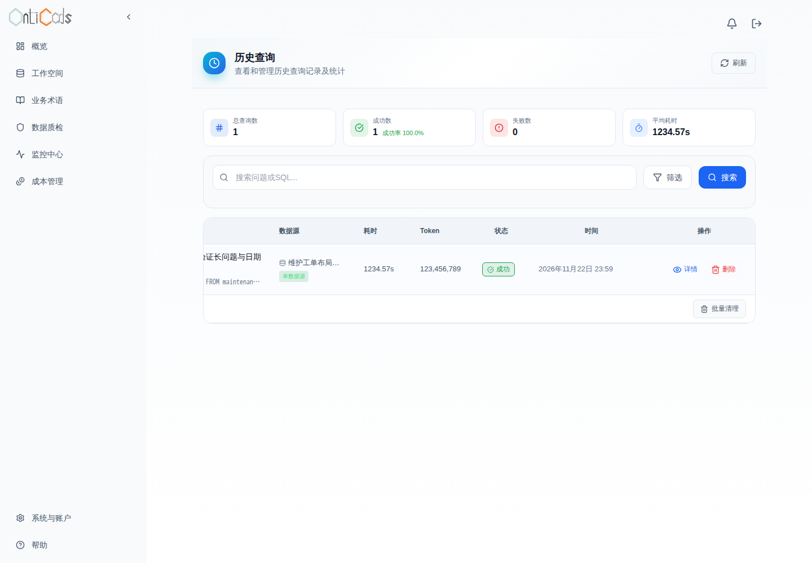
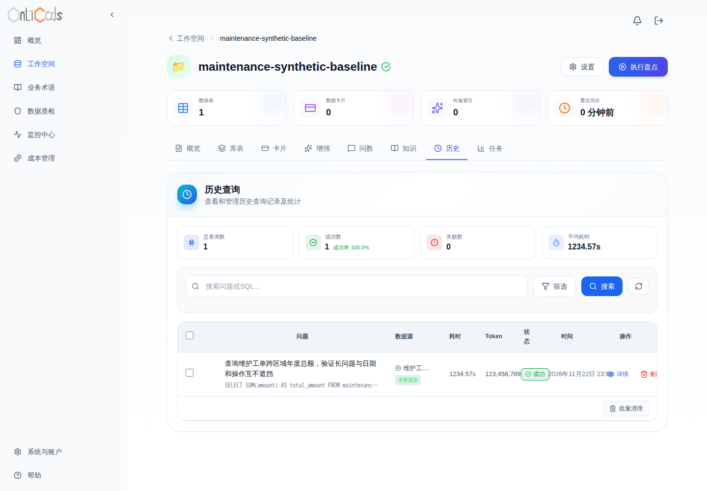
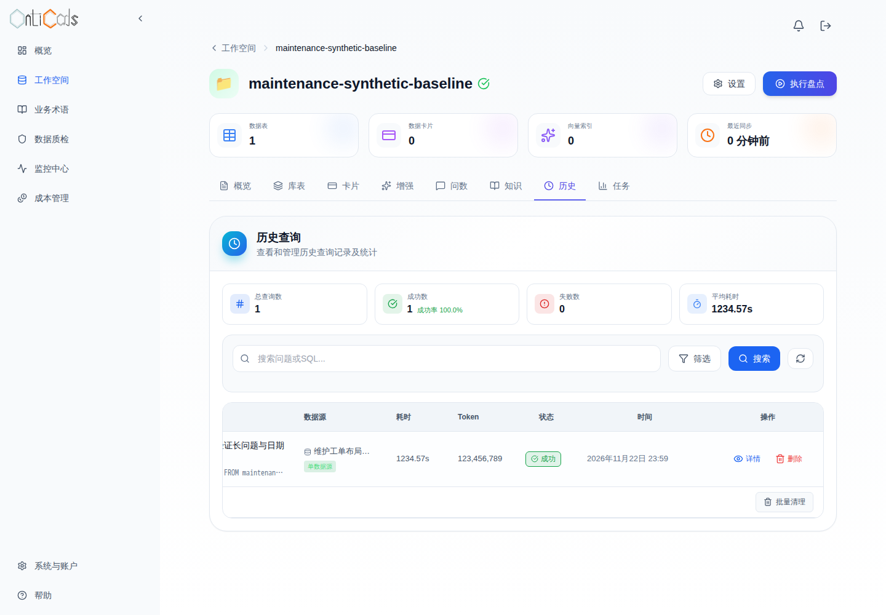
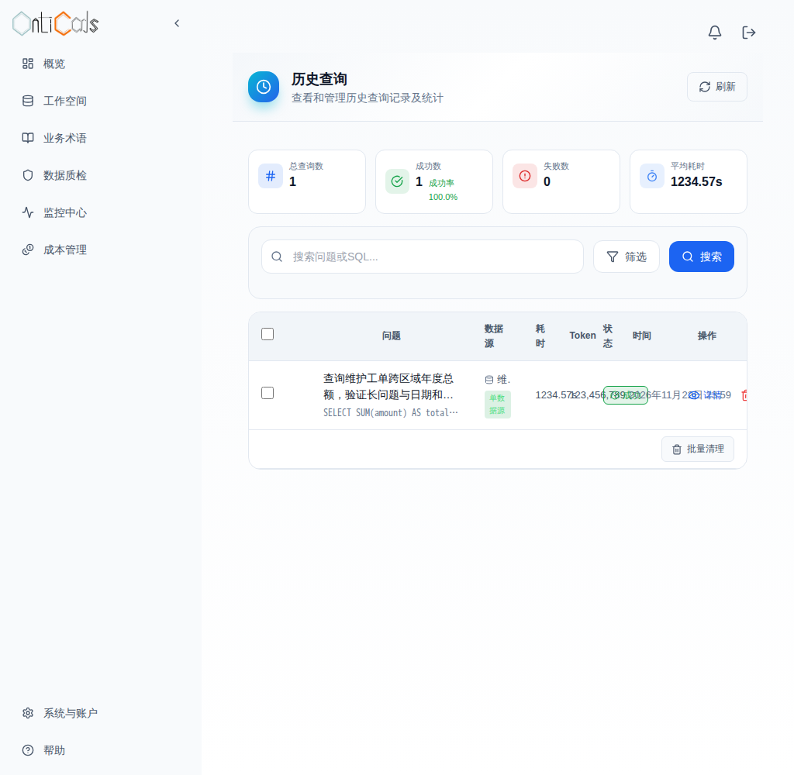
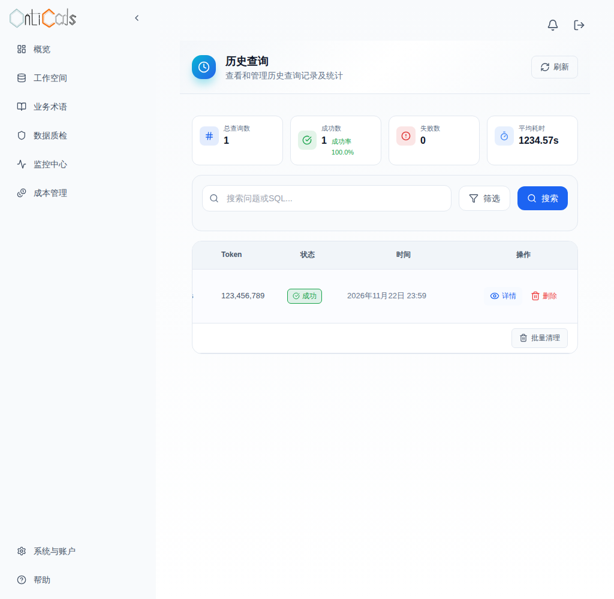
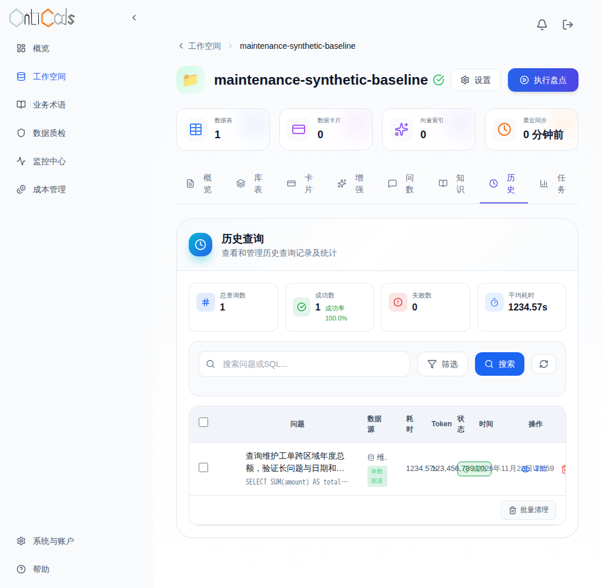
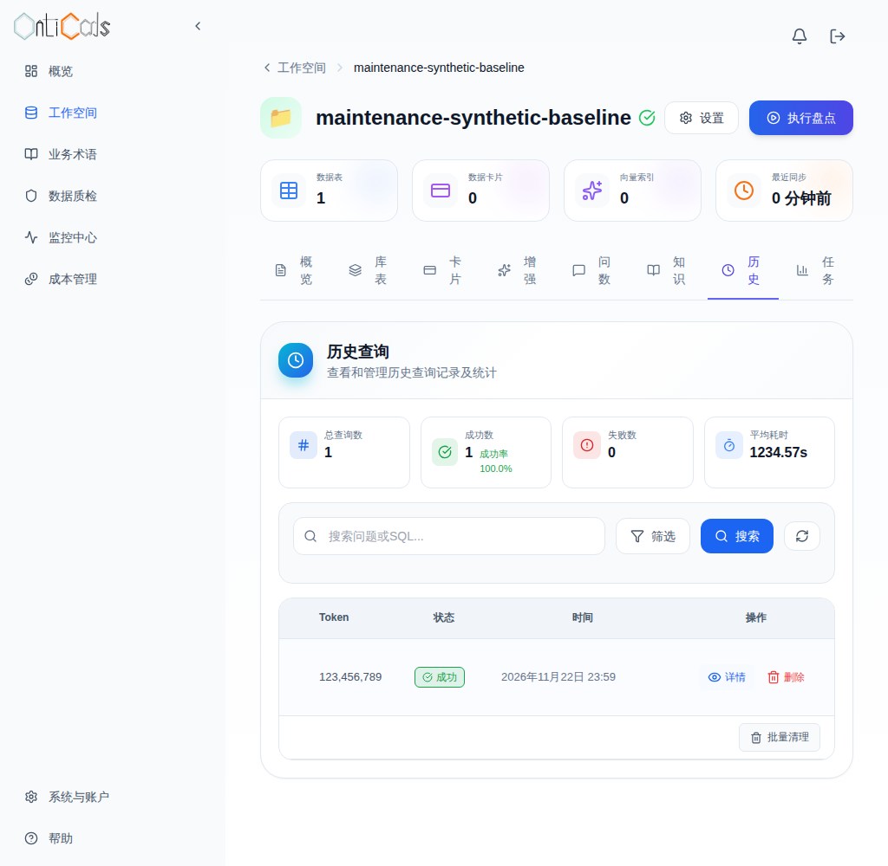

# PR #42：2026-11-05 当前版本验证证据

## 修复了什么

保留报告事实一致性修复：按表统计数据行，字段观测数单独统计，综合总结引用已存评分与评级。健康列身份也传入总结，避免没有缺失问题时把已知表列写成未知。查询历史为日期、Token和操作列保留空间，并允许表格局部横向滚动。

## 有什么作用

本次样本的3行数据和9次字段观测不再混淆，概览与总结均为100分／优秀。建议表列出已检测的 `maintenance_orders.amount/order_id/region`；无结果的其他模块仍保留未知。独立历史页与工作空间历史页在1440、1024宽度下可完整访问日期和操作。

## 验证结果

### 固定版本与镜像

- 原PR／分支：#42，`codex/report-facts-20261031`；保留原提交，以普通merge整合PR39合并后的main。
- 实际base：`f4fedcc084280ba4a57105180113e9d989e7487d`（读取真实 `git/ref/heads/main`，PR API曾缓存旧祖先aa3213，未据此误判main移动）。
- 构建、业务和布局 tested SHA：`fc328e9f7e2af3d36632e76ec871b1aedf0ee6d5`；完整源码tree：`02b82b23147b6fa390e445b86aac2343c378b79c`。
- API image：`sha256:07ce166fce7391b9010c52c0a1514a56ff3e1130bb062c635500d38b040b3523`。
- Web image：`sha256:8cb0d46edf231401079b1f923c3edc1a28a3be3285465f7f530f3573ab31d37b`。
- 在kol-stage2使用原始两个Dockerfile构建。初次直接rootless构建缺registry auth网络，随后复用原生隔离namespace入口成功；未启动旧controller。
- 固定Git tree、归档583个文件、远程SOURCE逐文件一致，独立审查也复核通过。源码tar SHA256：`0b7daa1bda25b08b8ded91f55abec86fe8af1bda0e25e0d7a8b48a2e8eca19f0`。
- 本目录只是后续保存的证据；其提交不改变上述已测API/Web/配置源码。最终审查需对实际head/base及生产目录tree相等性复核。

### 实际执行及失败保留

各次均使用同一固定源码和上述镜像，不将历史版本结果作为当前通过；以下为分阶段证据，未声称某个单一attempt完成全部验收。

| 本轮执行 | 实际结果 | 证据 |
|---|---|---|
| standalone／容器报告回归 | 26项通过；独立上下文在kol-stage2再跑26项通过 | [unit26.log](unit26.log) |
| r1完整链 | API7、真实提取/卡片/编辑成功；问数HTTP等待300秒超时，后续未运行；整个attempt exit1 | [失败](r1-http-failure.log)、[阶段](r1-stages.tsv) |
| r2业务与浏览器 | API7、实际阿里卡片/embedding/编辑/问数250、治理、XLSX/DOCX/MD导出、原浏览器3项通过 | [日志](r2-api-browser.log)、[检查](r2-checks.json)、[业务步骤](r2-flow.json) |
| r2后续旧版布局 | standalone确实几何溢出；workspace URL没有进入历史页，严格red gate拒绝；green未执行，整个attempt仍exit1 | [失败](r2-layout-failure.log)、[阶段](r2-stages.tsv) |
| targeted准备执行 | seed时连接重置；未运行报告/浏览器，整个attempt失败，清理完成 | [阶段](transport-failed-stages.tsv) |
| layout-only首次 | 旧seed helper未给created_at/updated_at赋值，当前init.sql要求NOT NULL且无默认值；未到浏览器，失败保留于内部原始证据 | 未改生产schema/model |
| layout2单独布局 | 修正夹具时间戳并通过真实“历史”按钮进入；旧版4项均仅因可测几何溢出而失败，新版4项通过，截图/操作可达/无页面横溢出断言通过；整个layout-only attempt exit0 | [阶段](layout-stages.tsv)、[red结果](layout-browser-red.json)、[green结果](layout-browser-green.json)、[red日志](layout-red.log)、[green日志](layout-green.log) |

r2原300秒HTTP超时与全部业务断言不变；r1超时原因仍未知。现有日志与query→embedding等待路径相符，但没有阻塞堆栈、供应商状态或固定base同环境对照，不能断言供应商故障或声称根因已修复。报告/布局变更没有进入该次超时前的直接调用路径，相关底层模块与base无diff；独立审查没有找到本PR导致该超时的直接证据。

layout2不调用模型、不供应凭据。其夹具使用真实隔离SQLite、真实管理员及工作空间；仅history list/stats/detail的GET响应使用固定压力数据，保留4个case、9列边界、PNG附件、按钮hit-testing、详情/删除取消、无写请求、workers1/retries0断言。修正导航只在旧、新两版本都点击已有“历史”按钮；未扩展产品URL参数支持。

实际命令入口：

```sh
python3 -m unittest discover -s OntiCards_Api/test -p test_report_summary_facts.py -v
# 在当前API容器
python -m unittest discover -s test -p test_report_summary_facts.py -v
flask db current
# 在现有固定测试镜像，/trusted-tests
python -m pytest -q test_preview_api.py --junitxml=/results/api.xml
node node_modules/@playwright/test/cli.js test tests/preview.spec.ts
node node_modules/@playwright/test/cli.js test tests/query-history-layout.spec.js --workers=1 --retries=0
```

模型配置：直接DashScope，`qwen3.8-max-0902`、`text-embedding-v4`；已有密钥只经受限stdin进入隔离后端模型配置。原始隔离返回、步骤/耗时及导出字节在内部归档保留；本目录提供允许公开的合成样本。应用部分入口不返回完整usage，报告包装丢弃底层usage，因此供应商完整调用数、重试、tokens和账单均未知，不能把缺失usage记为零。额外layout-only执行不产生模型消费。

### 报告全文

[实际Markdown](r2-report.md)未事后改写，SHA256：`5d4cd72b69ce2ed5814d499cd6d36873590f6f866672781efc141f8c8f60f0aa`。[有限语法事实校验](r2-report-facts.json)验证100／优秀、3行／9观测，不能替代语义审核。独立上下文已逐表核对：已检测空值行明确已知表列；另外两行未知只针对无结果的规则／关系模块；原因未知、建议先核查且条件化，没有冒认既有NOT NULL、默认值或录入机制。报告中的`None.maintenance_orders`是既有非LLM模板的空schema显示，不是本次新增，未扩大修复范围。

### 实际Before／After

Before Web：`50da42daf4f179d74668205c944e99f37cb9d53b`，image `sha256:e2ac0d69ffa3ae15ab0a9509705835b858cafe7dcabbd9a449b82468ea9ddee4`。其整个Web目录与实际base f4fedcc逐文件相同。After Web/API：上述tested SHA fc328e9。两边使用同一隔离后端、固定历史压力行和同一viewport（高度1000）；属于明确披露的旧Web控制组，不是旧版API混成新版业务通过。After图展示滚到右侧的完整日期与操作；左侧问题可横向滚回查看。

| 场景 | Before | After（滚到右侧） |
|---|---|---|
| 独立页1440 |  |  |
| 工作空间1440 |  |  |
| 独立页1024 |  |  |
| 工作空间1024 |  |  |

另有[实际问数250](attempt2-browser-2-real-query-total-250.png)、[真实治理详情](attempt2-browser-2-governance-real-report.png)、[截图版本/哈希清单](screenshots.json)和[文件校验和](sha256.json)。Before/After均为实际应用渲染，不是设计稿。

## 剩余限制

未运行GitHub托管CI，不把缺失checks记为通过；未操作生产DB或持久化卷升级。PDF/LibreOffice按要求未执行。XLSX/DOCX只验证实际文件格式、XML/表内容，未做打印布局或等同Markdown全文的语义验收。真实模型样本不能保证所有未来输出、自定义模板或其他模型均正确；有限自动gate对表格措辞仍有盲区，已用本次全文人工独审补足。r1原因未证实，失败没有被抹去。

测试项目容器、卷、网络由每轮trap定向清理，均有exit0收据。本轮镜像和临时源码在收证/终审后定向删除，最终清理结果记录在PR及工单；不清理共享在用/历史资源。
